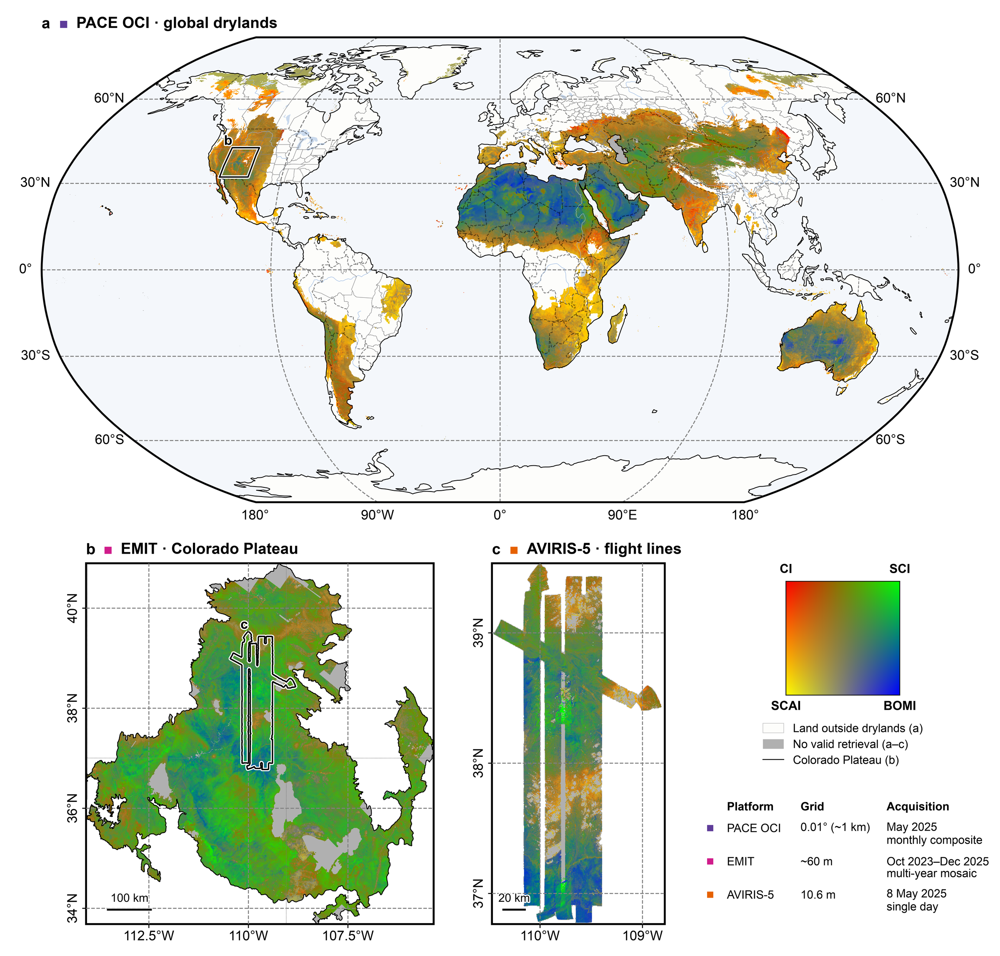
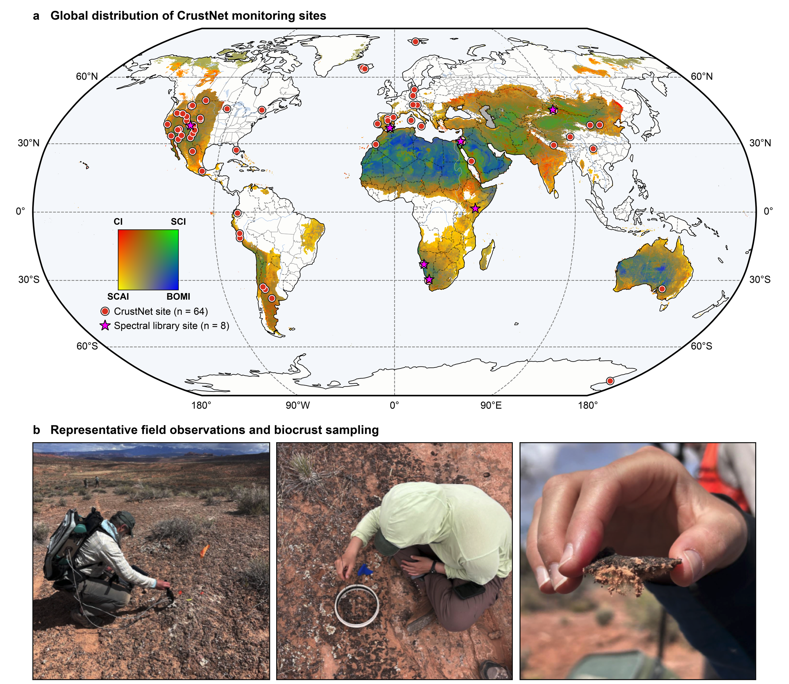

<div align="center">

<h1>New opportunities for global monitoring of vulnerable biological soil crusts</h1>

[Fujiang Ji](https://fujiangji.github.io/) <sup>1, *</sup>, [Sasha C. Reed](https://www.usgs.gov/staff-profiles/sasha-reed) <sup>2</sup>, [Miguel L. Villarreal](https://www.usgs.gov/staff-profiles/miguel-villarreal) <sup>3</sup>, [Arnon Karnieli](https://scholar.google.com/citations?user=IqpVkzMAAAAJ&hl=en) <sup>4, 5, 6</sup>, [Emilio Rodríguez-Caballero](https://orcid.org/0000-0002-5934-3214) <sup>7</sup>, [Bettina Weber](https://scholar.google.com/citations?user=3OccQs8AAAAJ&hl=de) <sup>8</sup>, [Wen Zhang](https://scholar.google.com/citations?user=lydsIFYAAAAJ&hl=zh-CN) <sup>1</sup>, [Joshua von Nonn](https://www.usgs.gov/staff-profiles/josh-von-nonn) <sup>3</sup>, [Cara Lauria](https://www.usgs.gov/staff-profiles/cara-marie-lauria) <sup>2</sup>, [Min Chen](https://globalchange.cals.wisc.edu/staff/chen-min/) <sup>9</sup>, [Juan Francisco Martinez Sanchez](https://www.researchgate.net/profile/Juan-Martinez-Sanchez-4/research) <sup>7</sup>, [William K. Smith](https://snre.cals.arizona.edu/people/william-smith) <sup>1, *</sup>

<sup>1</sup> School of Natural Resources and the Environment, University of Arizona, Tucson, AZ, USA  
<sup>2</sup> U.S. Geological Survey, Southwest Biological Science Center, Moab, UT, USA  
<sup>3</sup> U.S. Geological Survey, Western Geographic Science Center, Moffett Field, CA, USA  
<sup>4</sup> The Remote Sensing Laboratory, The Jacob Blaustein Institutes for Desert Research, Ben-Gurion University of the Negev, Sde Boker Campus, Israel  
<sup>5</sup> The Goldman Sonnenfeld School of Sustainability and Climate Change, Ben-Gurion University of the Negev, Israel  
<sup>6</sup> Data Science Research Center, Ben-Gurion University of the Negev, Israel  
<sup>7</sup> Department of Agronomy and Centro de Investigación de Colecciones Científicas (CECOUAL), Universidad de Almería, Almería, Spain  
<sup>8</sup> Division of Plant Sciences, Institute for Biology, University of Graz, Graz, Austria  
<sup>9</sup> Department of Forest and Wildlife Ecology, University of Wisconsin–Madison, Madison, WI, USA

</div>

<p align='center'>
  <a href="#"></a>
</p>

## Summary
* Biological soil crusts (biocrusts) are communities of cyanobacteria, lichens and/or bryophytes that colonize soil surfaces where climate limits vascular plant cover. They cover roughly 12% of Earth's terrestrial surface and act as ecosystem engineers of drylands, governing primary production, soil fertility and stability, hydrology, and erosion and dust dynamics, yet they remain poorly represented in satellite-derived ecological products and Earth-system models.
* This Perspective argues that a new generation of airborne and spaceborne imaging spectrometers (EMIT, PACE OCI, EnMAP, PRISMA, AVIRIS-5 and the forthcoming SBG and CHIME missions) creates an unprecedented opportunity to observe biocrusts from local landscapes to continental and global scales.
* **Spectral basis.** Pigments (scytonemin, carotenoids, phycobilins, chlorophyll a), hydration state, organic matter and mineral substrates imprint diagnostic features across the visible-to-shortwave-infrared spectrum (~380–2,500 nm). Field spectra from the Castle Valley climate-manipulation experiment (Colorado Plateau, USA) and a spectral library of eight dryland sites on four continents show that the same spectral regions matter across sites, and that hyperspectral models recover experimentally induced changes in biocrust fractional cover.
* **Multiscale observing system.** Four biocrust-sensitive indices (cyanobacterial crust index CI, scytonemin index SCI, biocrust organic matter index BOMI and satellite cellulose absorption index SCAI) are computed consistently from PACE (global, ~1 km), EMIT (regional, 60 m) and AVIRIS-5 (landscape, ~10 m) observations, illustrating a nested system rather than a collection of instruments.
* **Mixed pixels.** Spectral–spatial fusion (EMIT + PlanetScope to a 4-m hyperspectral product) and machine-learning upscaling from uncrewed aerial system (UAS) classifications to EMIT pixels provide practical routes to sub-pixel fractional cover of biocrust types.
* **From maps to mechanism.** Coordinated ground observations through the global CrustNet network of 64 monitoring sites provide the calibration and validation backbone needed to move from static maps to monitoring of disturbance, degradation, recovery and climate-driven community change, and to constrain models of carbon, nitrogen, water and dust.

This repository contains the Python scripts that generate the figures of the Perspective (`src_code/`) and reduced-size previews of the figures (`figs/`). The underlying datasets are not redistributed here (see [Data availability](#data-availability)).


<p align="center"><b>Fig. 4.</b> Cross-platform evaluation of biocrust-sensitive spectral indices from landscape to global scales: PACE OCI monthly composite over global drylands (a), EMIT mosaic of the Colorado Plateau (b) and AVIRIS-5 flight lines (c), all shown with the same four-index colour composite (CI, SCI, SCAI, BOMI).</p>

## Figures and the analyses behind them
| Figure | Script | Content | Main inputs |
|---|---|---|---|
| Fig. 1 | [plot_fig1_aridity.py](src_code/plot_fig1_aridity.py), [plot_fig1_spectra.py](src_code/plot_fig1_spectra.py), [plot_fig1.pptx](src_code/plot_fig1.pptx) | Conceptual diagram of multiscale hyperspectral monitoring of biocrusts; global dryland map and mean ± 1 s.d. field spectra of the four biocrust types, assembled in PowerPoint | TerraClimate aridity index (4 km) reclassified into UNEP classes; Castle Valley field spectra |
| Fig. 2 | [plot_fig2.py](src_code/plot_fig2.py) | Castle Valley climate-manipulation experiment: contact-probe spectra of LtCy, DkCy, lichen and moss with pigment absorption regions (a.1), random-forest feature importance (a.2), estimated vs. measured fractional cover (b) and treatment responses of successional stages and functional types (c) | ASD contact-probe library (n = 36 per type), random-forest importance and fine-tuned 1D-CNN estimates from the companion study ([Castle_valley_biocrust](https://github.com/FujiangJi/Castle_valley_biocrust)) |
| Fig. 3 | [plot_fig3.py](src_code/plot_fig3.py) | Global biocrust spectral library of eight dryland sites: dry and wet class-mean spectra with site-specific dominant wavelengths (PLS-R variable importance in projection) and their cross-site ranges (a); CI, SCI, BOMI and SCAI by biocrust type across sites (b) | Spectral library workbooks compiled by A. Karnieli (Negev, Namib, Colorado Plateau, Las Amoladeras, El Cautivo, Soebatsfontein, Gurbantünggüt, Wajir) |
| Fig. 4 | [plot_fig4.py](src_code/plot_fig4.py) | Four-index colour composite from PACE OCI (May 2025 monthly composite, drylands only), EMIT (Colorado Plateau mosaic, Oct 2023 – Dec 2025) and AVIRIS-5 (8 May 2025); also writes `Fig4_SI_single_indices` with each index on its own | Index GeoTIFFs computed from PACE OCI L2, EMIT L2A reflectance and AVIRIS-5 reflectance; TerraClimate aridity classes |
| Fig. 5 | [plot_fig5.py](src_code/plot_fig5.py) | Spatial enhancement of EMIT observations: RGB composites and CI, SCI, BOMI, SCAI from the original 60-m EMIT image and the fused 4-m hyperspectral image (EMIT + PlanetScope, deep hierarchical fusion network) | EMIT and fused index GeoTIFFs; sampling-scheme tiles |
| Fig. 6 | [plot_fig6.py](src_code/plot_fig6.py) | Upscaling biocrust fractional cover from UAS observations to EMIT: UAS orthomosaic and level-1 classification, class fractions per 60-m EMIT cell, EMIT-scale surface-composition and fractional-cover maps | UAS RGB orthomosaic (1 cm) and random-forest classification (2 cm); EMIT L2A scene of 5 April 2025 and its predicted cover |
| Fig. 7 | [plot_fig7.py](src_code/plot_fig7.py) | Global distribution of the 64 CrustNet monitoring sites and the eight spectral-library sites over the PACE four-index composite of Fig. 4a; representative field photographs | CrustNet site coordinates (https://crustnet.org); PACE composite via `plot_fig4.py` |


<p align="center"><b>Fig. 7.</b> CrustNet monitoring sites (red circles) and the eight spectral-library sites of Fig. 3 (magenta stars) over the PACE OCI four-index composite of global drylands.</p>

## Biocrust spectral indices
The indices used in Figs 3–5 and 7 follow Karnieli et al. (in review) and Noy et al. (2025); band names denote mean reflectance in the band:
* Cyanobacterial crust index, CI = 1 − (Red − Blue)/(Red + Blue)
* Scytonemin index, SCI = 1 − (Green − NUV)/(Green + NUV)
* Biocrust organic matter index, BOMI = 1 − √[(Blue² + Red² + NIR²)/3]
* Satellite cellulose absorption index, SCAI = (SWIR1 − SWIR2)/(SWIR1 + SWIR2)

Figures 4, 5 and 7 display the four indices as one colour composite: each pixel takes the colour of the position of its range-scaled indices in a two-dimensional key, so colours show the relative balance of the indices, not biocrust cover.

## Requirements
* `python>=3.9`
* `numpy`, `pandas`, `scipy`, `matplotlib`, `Pillow`, `openpyxl`
* `rasterio`, `cartopy`, `geopandas`, `shapely`, `pyproj` (Figs 1, 4–7)

All figures are sized for a double-column layout (183 mm wide), use Arial at 5–8 pt and are written as 1000-dpi PNG plus vector PDF with editable text (`pdf.fonttype 42`).

## Usage
* Clone this repository
  ```
  git clone https://github.com/FujiangJi/biocrust_perspective.git
  cd biocrust_perspective/src_code
  ```
* Point the `DATA_DIR` and `FIG_DIR` constants at the top of each script to your data and output folders.
* Generate the figures (run from `src_code/`, because `plot_fig3.py` and `plot_fig7.py` import the other scripts)
  ```
  python plot_fig1_aridity.py     # aridity classes + global dryland map (Fig. 1 background)
  python plot_fig1_spectra.py     # mean ± 1 s.d. spectra of the four biocrust types (Fig. 1 inset)
  python plot_fig2.py             # Fig. 2
  python plot_fig3.py             # Fig. 3  (imports plot_fig2 for the shared style)
  python plot_fig4.py             # Fig. 4 and Fig4_SI_single_indices
  python plot_fig5.py             # Fig. 5
  python plot_fig6.py             # Fig. 6  (needs the UAS orthomosaic)
  python plot_fig7.py             # Fig. 7  (imports plot_fig3 and plot_fig4)
  ```
  Fig. 1 is assembled from these outputs in [plot_fig1.pptx](src_code/plot_fig1.pptx). `plot_fig4.py` caches its decimated display arrays (`fig4_display_cache.npz`) after the first run; delete the cache to re-read the rasters.

## Description of files in this repository
* **`src_code/`**: figure scripts, one per figure.
  * **[plot_fig1_aridity.py](src_code/plot_fig1_aridity.py)**: reclassifies the TerraClimate aridity index into the five UNEP classes, writes global and western-US class rasters and renders the global dryland map used in Fig. 1 (and as the dryland mask in Figs 4 and 7).
  * **[plot_fig1_spectra.py](src_code/plot_fig1_spectra.py)**: mean ± 1 s.d. field reflectance of LtCy, DkCy, lichen and moss for the Fig. 1 conceptual diagram.
  * **[plot_fig1.pptx](src_code/plot_fig1.pptx)**: PowerPoint assembly of the Fig. 1 conceptual diagram.
  * **[plot_fig2.py](src_code/plot_fig2.py)**: Castle Valley spectral fingerprints with pigment absorption regions, random-forest feature importance ridgeline, estimated vs. measured cover with OLS fits and 95% confidence bands, and treatment response curves; also defines the shared Nature-style `rcParams`.
  * **[plot_fig3.py](src_code/plot_fig3.py)**: loads the eight-site spectral library, computes CI, SCI, BOMI and SCAI from class-mean spectra, and draws the per-site spectra with dominant-wavelength strips and the index distributions by biocrust type.
  * **[plot_fig4.py](src_code/plot_fig4.py)**: multiscale four-index composite (PACE → EMIT → AVIRIS-5) with a shared colour key; provides the composite, projection and key helpers reused by Fig. 7.
  * **[plot_fig5.py](src_code/plot_fig5.py)**: EMIT vs. fused 4-m hyperspectral imagery, RGB composites and index maps with linked zoom insets.
  * **[plot_fig6.py](src_code/plot_fig6.py)**: UAS-to-EMIT upscaling of biocrust fractional cover with ternary surface-composition map and per-class cover maps.
  * **[plot_fig7.py](src_code/plot_fig7.py)**: CrustNet and spectral-library sites over the PACE composite, with field photographs.
* **`figs/`**: reduced-size previews of Figs 2–7 for this README; the full-resolution figures are written by the scripts to `FIG_DIR`.

## Data availability
The field-spectroscopy, UAS, airborne (AVIRIS-5) and satellite (EMIT, PACE) datasets underlying the proof-of-concept figures will be deposited in a figshare repository upon publication (link to be added). The eight-site spectral library is described in Karnieli et al. (in review) and is available from the authors on reasonable request.

## Reference
If you use this code, please cite:
```
Ji, F., Reed, S.C., Villarreal, M.L., Karnieli, A., Rodríguez-Caballero, E., Weber, B., Zhang, W.,
von Nonn, J., Lauria, C., Chen, M., Martinez Sanchez, J.F., Smith, W.K. (in preparation).
New opportunities for global monitoring of vulnerable biological soil crusts.
```

## Contact
```
fujiang@arizona.edu
wksmith@arizona.edu
```

## Credits
* This research was supported by the National Aeronautics and Space Administration (NASA) Earth Surface Mineral Dust Source Investigation (EMIT) Science and Applications Team (Grant 80NSSC24K0858) and the U.S. Geological Survey (USGS) National Land Imaging (NLI) Program. Any use of trade, firm or product names is for descriptive purposes only and does not imply endorsement by the U.S. Government.
* The Castle Valley climate-manipulation experiment is maintained by the USGS Southwest Biological Science Center.
* The global biocrust spectral library was compiled by Arnon Karnieli and colleagues; CrustNet site information is provided by the CrustNet consortium (https://crustnet.org).
* EMIT data courtesy of NASA JPL and the LP DAAC; PACE OCI data courtesy of the NASA Ocean Biology DAAC; AVIRIS-5 data courtesy of NASA JPL.
